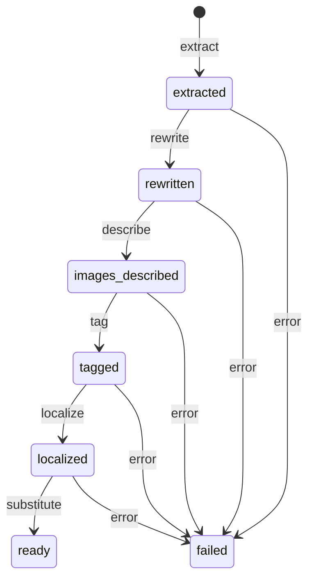
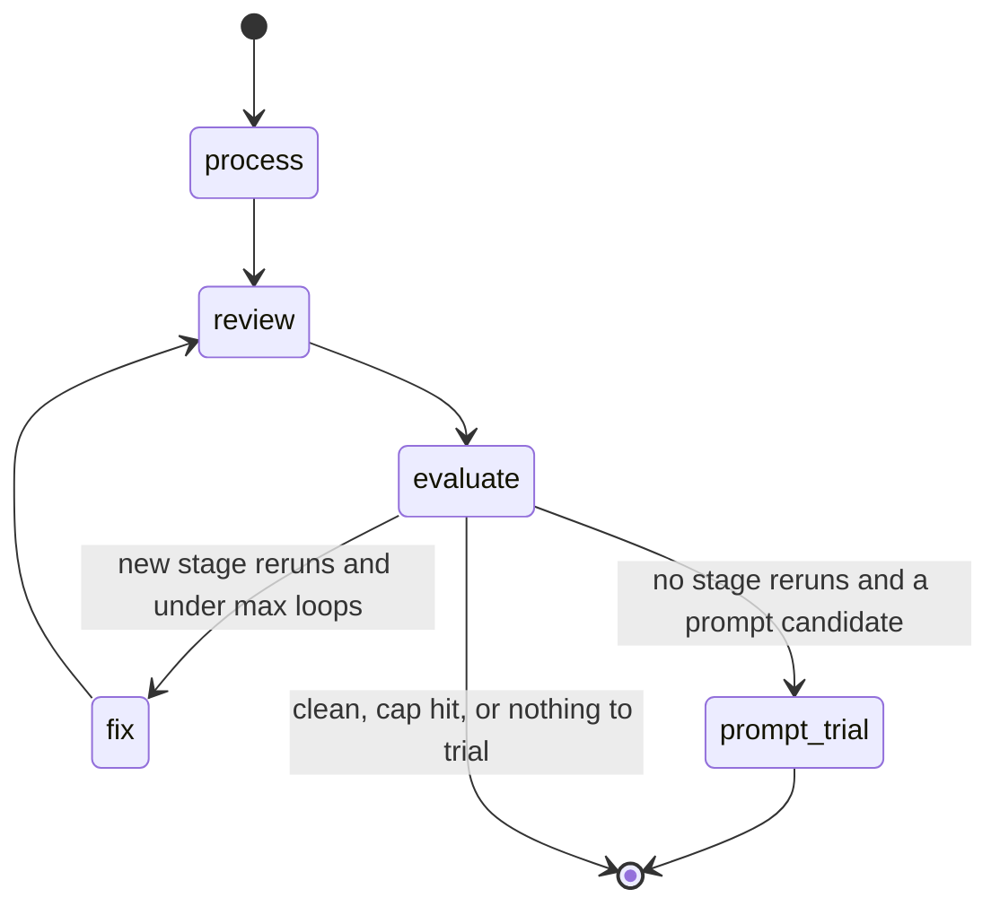

# Mexipes


Mexipes turns Mexican cookbook PDFs into structured, English-language recipes: ingredients, steps, tags, image descriptions, and US/Canada ingredient substitutions.

It was inspired by a project I did for the Data Mining and Statistical Learning course in Georgia Tech's MSc in Analytics. That project asked whether ingredient lists alone can show regional differences inside a cuisine that usually gets lumped into one category. Mexican food is a good test case. It changes a lot from region to region, its traditional cuisine is on UNESCO's Intangible Cultural Heritage list, and outside Mexico it is mostly known through Tex-Mex and its later adaptations. Getting the data was the hard part, so this repo focuses on building a clean, curated recipe dataset.

Some things you could do with it:

- Auto-tag recipes by region for recipe sites and apps like Allrecipes or Kiwilimon, so people can find dishes from a specific part of Mexico.
- Train or evaluate recipe-generation models on Mexican cuisine.
- Look at ingredient usage, flavor pairings, or nutrition across regions.
- Give chefs, product developers at food companies and restaurant chains, and culinary researchers a large set of traditional recipes to work from.

Publications move through file-based stages. The pipeline extracts recipes and crops food photos, rewrites the Spanish text, describes images, tags on Spanish text, localizes the recipe and tags into English, and applies US and Canada ingredient substitutions. Outputs land as JSON under `data/publications/`. `mexipes recommend` builds a tag-overlap similarity index for related-recipe suggestion.

LLM calls go through LiteLLM and instructor. Defaults use Gemini (`gemini/gemini-2.5-flash` and `gemini/gemini-2.5-pro`). Override the model per stage with `MEXIPES_*_MODEL`.

## What it does

- Ingests PDFs with validation and MD5 deduplication
- Extracts recipes from overlapping page chunks and crops food photography
- Rewrites Spanish recipe text (structure and order shuffled for paraphrase)
- Describes plate styling and writes text-to-image style prompts
- Tags course, protein, spiciness, budget, equipment, chiles, and related facets
- Localizes recipes and tag sets into English (slugs and short cultural intros)
- Suggests ingredient substitutions for US and Canada pantries
- Runs advisory AI review personas on sampled recipes without changing pipeline data
- Closes the loop with `mexipes workflow`: process to ready, review, auto-rerun stages (capped), and trial prompt changes on a copy before suggesting a commit

## Architecture

A **publication** is one cookbook PDF registered under `data/publications/<id>/`. A **recipe** is one dish extracted from that PDF, stored as JSON files under `recipes/<recipe_id>/`.

Each recipe moves through named **stages**. A stage is a Python function that reads the prior JSON (and sometimes the PDF), calls an LLM when needed, writes a new JSON file, and updates `status.json`. Stages in order:

| Stage | Writes | Role |
|-------|--------|------|
| `extract` | `extracted.json` | Pull Spanish recipes and crop food photos from the PDF |
| `rewrite` | `rewritten.json` | Paraphrase Spanish text so it is not a verbatim copy |
| `describe` | `images_described.json` | Describe plate photos and draft text-to-image prompts |
| `tag` | `tags.json` | Classify the Spanish rewrite (course, protein, region, …) |
| `localize` | `localized.json`, `localized_tags.json` | Translate recipe and tags into English |
| `substitute` | `substitutions.json` | Suggest US/Canada pantry swaps for hard-to-source ingredients |

`status.json` holds the recipe's place in that chain (`extracted`, `rewritten`, `images_described`, `tagged`, `localized`, `ready`, or `failed`). Tagging runs on Spanish before localization so English labels stay aligned with the Spanish taxonomy. The `describe` stage name and the `images_described` status/file name differ on purpose.



### Quality review

**Review** is a separate LLM pass over finished (or nearly finished) recipes. Four **personas** each check one concern: extraction fidelity to the PDF, rewrite fidelity, taxonomy, and English localization / substitutions. Each persona returns **findings** (issue, evidence, suggested action).

A **consolidator** LLM then merges those findings across recipes into one plan: which stages to rerun, which prompts might need editing, which DQ rules might need code changes, and what still needs a human. Review artifacts land under `data/reviews/` and do not change recipe JSON by themselves. That is what `mexipes review` does.

**Data quality (DQ)** checks are deterministic rules (`mexipes dq`): missing fields, invalid enum values, broken cross-stage links. They feed into review as context; they do not rewrite data.

### Closed workflow (`mexipes workflow`)

Manual work often looked like: run stages → review → pick a stage to rerun → cascade later stages → review again. `mexipes workflow` automates that loop with [LangGraph](https://langchain-ai.github.io/langgraph/), a library for stateful graphs (nodes + conditional edges). It does not replace the stage functions; it calls them in order, then decides whether to fix and review again.



- **process**: Register any PDFs in `data/staging/`, extract recipes, and run every stage until each recipe is `ready` or `failed`. With `--publication N`, only that book. Without it, every registered publication (same coverage as `mexipes all`).
- **review**: Run the four personas and the consolidator on the publications just processed. First pass covers every recipe in those books; later passes cover only recipes that were just fixed. Still writes only under `data/reviews/`.
- **evaluate**: No LLM. From the consolidator's stage-rerun list, keep the earliest stage per recipe among `rewrite`, `describe`, `tag`, `localize`, and `substitute`. Skip `extract` (that re-extracts the whole book) and skip any `(publication, recipe, stage)` already tried this run. If anything remains and fix count is under `--max-loops` (default 3), go to **fix**. Else if the consolidator still wants a prompt change, go to **prompt_trial**. Otherwise stop (`clean`, `no_new_reruns`, or `max_loops`).
- **fix**: Copy each affected recipe directory to `data/backups/<timestamp>/`, rerun the chosen stage, then advance that publication's remaining stages until `ready` again. Review runs once more after the last allowed fix; that last review does not trigger another fix round.
- **prompt_trial**: Rewrite one pipeline prompt into a temporary directory (packaged prompts under `src/mexipes/prompts/` stay untouched). Rerun the matching stage on a temporary copy of at most three recipes cited by the findings. Re-run the relevant personas. Print a unified diff only if every target finding is gone and no new finding appears. Failures print one line; consolidator prose about DQ/code changes is never treated as ready to apply.

`mexipes run` still advances at most `--batch` recipes by a single stage. Use it for surgical retries. Prefer `mexipes workflow --publication N` when you want the full closed loop.

## Requirements

- Python 3.12 or newer
- An LLM provider API key for real PDF runs. Defaults expect `GEMINI_API_KEY` from [Google AI Studio](https://aistudio.google.com/). Other LiteLLM providers need their own keys (see LiteLLM docs)
- `make test` needs no API key (unit tests only)

Install is local and editable (`pip install -e ".[dev]"`). There is no published PyPI package yet.

### Model and provider caveats

- **Tested with Gemini.** Day-to-day development and QA use Google Gemini through LiteLLM (`gemini/…` model IDs). Other providers are wired the same way but are not regularly validated here.
- **Vision required for some stages.** `extract` and `describe` send PDF page bytes or images. Those stages need a vision-capable model. Text-only models will fail or produce empty/wrong crops and descriptions.
- **Structured JSON assumed.** Responses go through [instructor](https://python.useinstructor.com/) into Pydantic schemas. Providers that struggle with strict JSON schemas will surface as retries or stage failures.
- **Defaults mix Flash and Pro.** Most stages default to `gemini-2.5-flash`. Rewrite, review, and consolidate default to `gemini-2.5-pro`. Override with `MEXIPES_*_MODEL` (see Setup).
- **Free-tier limits.** Google AI Studio’s free tier can run Flash without a paid plan, but daily request caps are low and Pro may be unavailable. Check [your project’s rate limits](https://aistudio.google.com/rate-limit). A full `mexipes workflow` pass (many persona calls per recipe, plus possible fix loops) can exhaust free quota quickly; start with one small PDF, `--publication N`, and `--max-loops 1`.
- **Gemini-only request options.** The LLM wrapper disables Gemini “thinking” and sets `drop_params=True` so non-Gemini providers ignore unknown kwargs. Behavior still depends on the provider.

## Setup

```bash
make setup
```

This installs dependencies in editable mode, installs git hooks, and copies `.env.example` to `.env` if needed. Prefer the editable install so edits under `src/mexipes/` (including prompts) take effect without reinstalling.

Edit `.env`:

```ini
GEMINI_API_KEY="your-api-key-here"
MEXIPES_DATA_DIR="./data"
```

Optional per-stage model overrides (LiteLLM model IDs):

```ini
MEXIPES_EXTRACTION_MODEL="gemini/gemini-2.5-flash"
MEXIPES_REWRITE_MODEL="gemini/gemini-2.5-pro"
MEXIPES_TAGGING_MODEL="gemini/gemini-2.5-flash"
```

### Sample PDFs

The repo does not bundle cookbook PDFs. Copy your own files into `data/staging/` (flat directory, no subfolders) before `mexipes ingest`. For smoke tests, keep a small set in `data/sample_pdfs/` and copy one file at a time into staging (see [Scoped runs](#scoped-runs)).

## Pipeline stage order

```
extract → rewrite → describe → tag → localize → substitute → ready
```

See [Architecture](#architecture) for what each stage writes, how `status.json` advances, and how `mexipes workflow` wraps stages with review and capped fixes.

## Usage

### 1. Ingest new publications

```bash
mexipes ingest data/staging/
```

Validates PDFs, deduplicates by MD5, moves invalid files to `data/rejected/`, and registers publications under `data/publications/<publication_id>/`.

### 2. Run the closed workflow (recommended)

```bash
mexipes workflow --publication 1 --max-loops 3
```

Processes to ready, reviews, auto-reruns consolidator stage recommendations (with backups under `data/backups/`), and may trial one prompt change on a copy. Prefer `--publication` so review cost stays bounded. Without it, every registered publication is processed and reviewed.

For surgical one-stage advancement, use `mexipes run` / `mexipes all` as below.

### 3. Run the pipeline one stage at a time

```bash
mexipes run --batch 10
```

Each invocation advances at most `--batch` recipes by one stage. Large publications need repeated runs. Example loop until a few recipes reach `ready`:

```bash
while [ "$(grep -rl '"ready"' data/publications/*/recipes/*/status.json 2>/dev/null | wc -l | tr -d ' ')" -lt 3 ]; do
  mexipes run --publication 1 --batch 10
  mexipes status --publication 1
done
```

#### Scoped runs

Process one book at a time:

```bash
mexipes run --publication 1 --batch 10
```

Run a single stage for one recipe:

```bash
mexipes run --recipe 1:1 --stage tag
```

Valid stage names: `extract`, `rewrite`, `describe`, `tag`, `localize`, `substitute`.

### 4. Check status

```bash
mexipes status
mexipes status --publication 1
```

### 5. Data quality checks

```bash
mexipes dq
mexipes dq --publication 1 --verbose
```

Exits with code 1 when any errors are found. Warnings alone still pass.

### 6. On-demand quality review

`mexipes review` samples pipeline outputs, attaches the relevant source PDF pages, and asks reviewer personas to produce findings with evidence. The command is advisory: it writes only under `data/reviews/` and leaves `data/publications/` alone. Processed publications are read through a read-only store. For automatic stage reruns after review, use `mexipes workflow` instead.

Page fields (`page_start` / `page_end`, and publication `recipe_index` pages) are 1-based PDF document indices, not printed book page numbers. A recipe on PDF page 13 that shows "15" in the footer is correct.

```bash
mexipes review                              # 3 random publications x 3 random recipes
mexipes review --publications 5 --recipes-per-pub 4 --seed 42
mexipes review --publication 1 --recipes 1-25 --no-process
mexipes review --only-dq --personas extraction,taxonomy
```

Defaults keep the sample small (`--publications/-P 3`, `--recipes-per-pub/-n 3`). If a sampled PDF from `--corpus-dir` is not processed yet, review ingests and runs the pipeline inside the run's `_workspace/` subdirectory (not `data/publications/`) unless `--no-process` is set. All review output lives under `data/reviews/review_<timestamp>_<seed>/` and is gitignored.

Typical workflow:

1. Prefer `mexipes workflow --publication N` when you want process + review + capped stage reruns in one pass.
2. Or generate data with `mexipes run` / `mexipes all`, then `mexipes dq`, then `mexipes review` for a sampled advisory pass.
3. Triage findings in `consolidated.json`. Each finding starts with `triage_notes` set to `PLACEHOLDER`.
   - one-off data issue: targeted rerun, e.g. `mexipes run --recipe 1:2 --stage tag`, or let `mexipes workflow` apply consolidator reruns
   - systemic prompt issue: only commit a prompt diff that `mexipes workflow` printed after a passed prompt trial
   - DQ / code issue: still human-edited; the workflow does not trial generated Python
   - weak or subjective issue: ignore, or leave as consolidator `human_review`
4. After a prompt commit, re-run `mexipes workflow` or `dq` + `review` on a fresh sample.

Review and consolidate models use `MEXIPES_REVIEW_*` and `MEXIPES_CONSOLIDATE_*`.

### 7. Export

```bash
mexipes export --output recipes.json --status ready
```

Writes:

- `recipes.json`: consolidated recipe objects (original, rewritten, localized, tags, substitutions)
- `recipes_facets.json`: inverted facet index (slug → `publication_id:recipe_id`) for browse and filter UIs

### 8. Similarity index (optional)

```bash
mexipes recommend --export recipes.json --output recipes_similar.json
```

Computes top-N tag-overlap neighbors per recipe from the export file. Use this for related-recipe suggestion.

## Data layout

```
data/
├── staging/              # drop new PDFs here
├── rejected/             # invalid or duplicate PDFs
├── sample_pdfs/          # optional holding area for smoke-test PDFs
├── reviews/              # gitignored mexipes review artifacts
├── backups/              # gitignored recipe copies before workflow stage reruns
└── publications/
    └── <id>/
        ├── source.pdf
        ├── publication_info.json
        ├── metadata.json
        └── recipes/
            └── <recipe_id>/
                ├── extracted.json
                ├── rewritten.json
                ├── images_described.json
                ├── tags.json
                ├── localized.json
                ├── localized_tags.json
                ├── substitutions.json
                ├── status.json
                └── images/
```

## FAQ

### Where do PDFs go, and do I commit them?

Put source PDFs in `data/staging/` for ingest. After ingest they live under `data/publications/<id>/source.pdf`. Sample and corpus PDFs are not part of the repo. Keep large PDF trees out of git (see `.gitignore`).

### Why tag before English localization?

Tags are assigned on Spanish rewritten text. The localize stage then translates both the recipe and the tag set, so English labels stay aligned with the controlled vocabulary mapping.

### Why is the status `images_described` instead of `described`?

The stage CLI name is `describe`, but the status and output file use `images_described` / `images_described.json`.

### Why do recipes move slowly? What does `--batch` do?

Each `mexipes run` advances at most `--batch` recipes (default 10) by a single stage. Re-run until recipes reach `ready`, or raise `--batch` if you want wider batches per invocation.

### Are PDF page numbers the same as printed book pages?

No. Stored page fields are positions in the PDF file (1-based). Printed footer or ToC numbers often differ by a fixed offset. That mismatch is expected.

### Does `mexipes review` change pipeline data?

No. `mexipes review` writes only under `data/reviews/` and never mutates `data/publications/`. `mexipes workflow` can rewrite stage JSON after copying the recipe directory to `data/backups/`, but only for consolidator `recommended_reruns` in `rewrite`…`substitute`. Prompt files are never written by either command; a prompt trial may print a validated diff for you to commit.

### Can I use a model other than Gemini?

Yes, in principle. Calls go through LiteLLM; set `MEXIPES_*_MODEL` to that provider’s LiteLLM model ID and supply its API key. Keep a vision model on `extract` and `describe`. See [Model and provider caveats](#model-and-provider-caveats): this repo is validated on Gemini, not as a multi-provider matrix.

### Are rewritten recipes safe to publish?

The rewrite stage paraphrases Spanish text so the output is not a verbatim copy of the source. You still need rights to process the PDFs and to redistribute anything you publish from them.

### Where should AI agents look for deeper context?

See [AGENTS.md](AGENTS.md) for pipeline invariants, status mapping, and workflow guides.

## Troubleshooting

| Symptom | Cause | Fix |
|---------|-------|-----|
| Recipes stuck at `extracted` / `rewritten` / … | `--batch` limit reached | Re-run `mexipes run --publication N --batch 10` |
| Publication stays `registered` | Extraction chunk failed | Check logs; re-run `mexipes run --publication N --stage extract` |
| Recipe status `failed` | Stage exception | Read `status.json` for the error; retry with `--recipe N:M --stage <name>` |
| `ImportError: dotenv` | Missing dependency | Run `pip install -e .` (includes `python-dotenv`) |
| Large PDF (>10 MB) | API payload limits | Pipeline converts pages to JPEGs during LLM calls |
| Fewer recipes than expected after extract | Section-local `recipe_number` from source PDF | Storage IDs are sequential; re-run `--stage extract` after clearing `recipes/` |
| Stale `metadata.json` after prompt/logic change | `--stage extract` reuses existing metadata | Delete `metadata.json` or call `extract_publication_metadata(...)` (below) |

### Re-running metadata extraction

Recipe extraction (`--stage extract`) does not regenerate `metadata.json` when the file already exists. To refresh publication metadata after a prompt or sanitization change, delete `data/publications/<id>/metadata.json` or run:

```python
from mexipes.config import settings
from mexipes.storage import RecipeStore
from mexipes.stages.extract import extract_publication_metadata

extract_publication_metadata(RecipeStore(settings.data_dir), publication_id=1)
```

After metadata changes, `tags.json` is stale until recipes are re-tagged (inherited tags merge at tag time). Re-run `mexipes run --publication N --stage tag` on affected recipes, then advance through localize and substitute if they were already `ready`.

## Development

```bash
make setup    # install deps + pre-commit/pre-push git hooks (once per clone)
make format   # ruff format
make lint     # ruff check --fix
make check    # CI-equivalent lint + format check (no auto-fix)
make test     # pytest (no API key needed)
make clean    # remove caches
```

Git hooks from `make setup` run ruff on commit and `make check` plus `make test` on push. If hooks are not installed, run `make check` before pushing.

## License

MIT. See [LICENSE](LICENSE).
